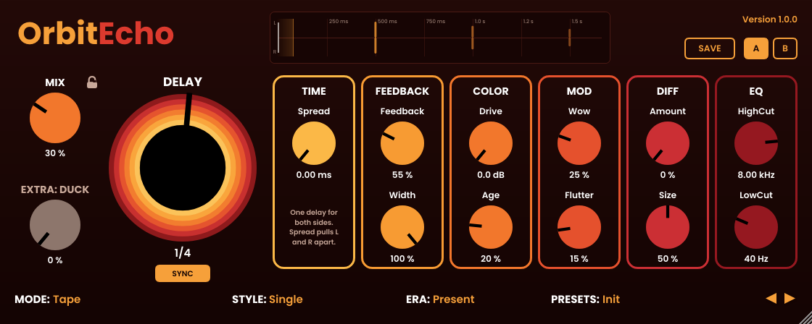

# Orbit Echo

Delay algorítmico estéreo **multimodo**: ecos de cinta, BBD (bucket brigade), digitales de los 80,
pitch shifting, frequency shifting, phaser y difusión, todo **dentro del lazo de retroalimentación**,
así que cada repetición acumula su propio carácter. Plugin **VST3**, **AU** y **CLAP** (más
Standalone) hecho con JUCE 8 para **Windows y macOS** (y Linux), con **FL Studio** como host
principal de pruebas.



- **17 modos** (Mode) × **5 topologías L/R** (Style) × **3 Eras** — tape, BBD, digital, pitch, frequency shift, phaser.
- Delay de **0 ms a 20 s**, sincronizable (1/64 … 4 compases, tresillos y con puntillo).
- Feedback hasta **200 %** con auto-oscilación controlada; nunca supera −0.3 dBFS.
- **Latencia 0**, CPU baja (≈ 0,7–4 % de un núcleo por instancia a 48 kHz), salida idéntica con cualquier tamaño de bloque.
- Interfaz plana de colores cálidos, redimensionable (75–200 %): perilla DELAY con anillos, secciones por color, barra MODE / STYLE / ERA / PRESETS, visualizador de ecos, **28 presets** de fábrica, presets de usuario, A/B y Mix Lock.

---

## Instalación

Descarga el zip de tu sistema desde la página **Releases** del repositorio (o desde los artefactos
de la última ejecución de *Actions*): `OrbitEcho-Windows-VST3.zip`, `OrbitEcho-Windows-CLAP.zip`,
`OrbitEcho-macOS-VST3.zip`, `OrbitEcho-macOS-AU.zip`, `OrbitEcho-macOS-CLAP.zip`, etc.

### FL Studio en Windows

1. Descomprime `OrbitEcho-Windows-VST3.zip` → carpeta `Orbit Echo.vst3`.
2. Cópiala a `C:\Program Files\Common Files\VST3\` (pide permiso de administrador).
   *Opcional:* el CLAP (`Orbit Echo.clap`) va en `C:\Program Files\Common Files\CLAP\` (FL Studio 2024 o posterior).
3. En FL Studio: **Options → Manage plugins → Find installed plugins** (o *Find more plugins*).
4. Busca **Orbit Echo** (categoría *Effects*), marca la estrella para tenerlo a mano y cárgalo en una
   ranura del Mixer.

No necesita el runtime de Visual C++ (está enlazado estáticamente).

### FL Studio, Ableton Live, Reaper, Bitwig… en macOS

| Formato | Carpeta |
|---|---|
| VST3 | `~/Library/Audio/Plug-Ins/VST3/Orbit Echo.vst3` |
| AU | `~/Library/Audio/Plug-Ins/Components/Orbit Echo.component` |
| CLAP | `~/Library/Audio/Plug-Ins/CLAP/Orbit Echo.clap` |

El binario es universal (Apple Silicon + Intel, macOS 10.13 o posterior) y tiene firma *ad-hoc*.
Como no está notarizado, si macOS lo bloquea (*"no se puede abrir"* / el DAW no lo ve) quita la
cuarentena y vuelve a escanear:

```bash
xattr -dr com.apple.quarantine ~/Library/Audio/Plug-Ins/VST3/"Orbit Echo.vst3"
xattr -dr com.apple.quarantine ~/Library/Audio/Plug-Ins/Components/"Orbit Echo.component"
xattr -dr com.apple.quarantine ~/Library/Audio/Plug-Ins/CLAP/"Orbit Echo.clap"
```

- **FL Studio (Mac):** *Options → Manage plugins → Find installed plugins*. Usa VST3, AU o CLAP.
- **Ableton Live:** *Settings → Plug-Ins →* activa *Use VST3 Plug-In System Folders* (y *Audio Units*) → *Rescan*.
- **Reaper:** *Settings → Plug-ins → VST/CLAP → Re-scan*.
- **Bitwig:** detecta VST3 y CLAP de las carpetas del sistema automáticamente.

### Logic Pro y GarageBand (AU)

Copia `Orbit Echo.component` a `~/Library/Audio/Plug-Ins/Components/`, quita la cuarentena (arriba)
y **reinicia Logic**: valida el plugin al arrancar. Si aparece como fallido, abre *Logic Pro →
Settings → Plug-in Manager*, selecciónalo y pulsa *Reset & Rescan Selection*. GarageBand lo muestra
en *Plug-ins → Audio Units → Alejandro Audio*. (El AU pasa `auval -strict` en cada build.)

### Ableton Live, Reaper, Bitwig, Studio One, Cubase en Windows

Las rutas son las mismas para todos: `C:\Program Files\Common Files\VST3\` (VST3) y
`C:\Program Files\Common Files\CLAP\` (CLAP).

- **Ableton Live:** *Options → Preferences → Plug-Ins →* activa *VST3 System Folders* → *Rescan*.
- **Reaper:** *Options → Preferences → Plug-ins → VST* (y *CLAP*) → *Re-scan*.
- **Bitwig:** *Settings → Locations →* las carpetas del sistema ya están; reinicia o *Rescan*.
- **Studio One:** *Options → Locations → VST Plug-ins → Reset Blocklist / Rescan*.
- **Cubase:** *Studio → VST Plug-in Manager →* botón de *Rescan*.

### Linux

VST3 en `~/.vst3/`, CLAP en `~/.clap/` (Reaper, Bitwig).

### Consejos para FL Studio

- **Smart Disable** funciona: el plugin queda en silencio absoluto cuando la entrada y los ecos se
  apagan (el ruido de *Age* sigue a la señal, no hay siseo de fondo) y declara la cola real
  (60 s con Feedback ≥ 100 %), así que FL no corta los ecos ni al exportar.
- Funciona con **cualquier tamaño de buffer** y con *"Use fixed size buffers"* activado o no; el
  resultado es idéntico (probado con bloques de 1 a 8192 muestras).
- Seguro con el procesamiento **multinúcleo** del Mixer (sin estado estático compartido entre
  instancias) y sin asignaciones de memoria en el hilo de audio.
- La ventana se escala sola con el DPI de Windows; además puedes arrastrar la esquina (75–200 %).
- La automatización usa IDs estables: los proyectos guardados se abren igual en versiones futuras.

---

## Controles

### Mode (algoritmo)

| Mode | Qué es | Mod (2 perillas) | Age |
|---|---|---|---|
| **Tape** | Eco de cinta de velocidad variable: wow/flutter y tono siguen al tiempo de delay | Wow, Flutter | Ruido de asperidad + empalmes (splices) |
| **Tape Clean** | Cinta de cromo: saturación más fina y brillante, mucho menos ruido, sin empalmes | Wow, Flutter | Ruido leve |
| **Reel HiFi** | Magnetófono de estudio: banda completa, wow/flutter independiente del tiempo | Mod Rate, Mod Depth | Ruido de asperidad |
| **Tape NR** | Cinta con reducción de ruido (compansión): brillante, casi sin ruido. *Duck* | Wow, Flutter | Ruido muy leve |
| **BBD** | Chip bucket brigade: compander, filtros oscuros, ruido que sigue a la dinámica | Mod Rate, Mod Depth | Ruido del chip |
| **BBD Bright** | BBD cuyo brillo sigue al tiempo (reloj): cortos brillantes, largos oscuros. *Duck* | Mod Rate, Mod Depth | Ruido del chip |
| **Analog+** | BBD moderno: ~2× ancho de banda, ~½ ruido, saturación más gruesa | Mod Rate, Mod Depth | Ruido reducido |
| **Digital** | Rack digital de los 80 con conversor de punto flotante | Mod Rate, Mod Depth | Bits del conversor (50 % = 12 bits) |
| **Clean** | Digital limpio con limitador dependiente del programa en el lazo. *Duck* | Mod Rate, Mod Depth | Ancho de banda |
| **Crystal** | Transparente para loops: Low/High Cut fuera del lazo, repeticiones brillantes | Mod Rate, Mod Depth | Bits |
| **LoFi** | Reducción de sample rate con aliasing y bitcrush. *Duck* | Mod Rate, Mod Depth | Cantidad de degradación |
| **Ghost Shift** | Cinta HiFi + frequency shifter + difusión dependiente de la frecuencia | Freq Shift, Freq Detune | Ruido de asperidad |
| **Pitch** | Pitch shifter granular dentro del lazo: espirales que suben o bajan | Pitch Shift, Pitch Detune | Bits |
| **Pitch Rich** | Ruta transpuesta + ruta desafinada "lush"; con difusión alta, shimmer | Pitch Shift, Pitch Detune | → **Pitch Mix** |
| **Pitch Reverse** | Segmentos invertidos (tamaño = Delay) y transpuestos | Pitch Shift, Pitch Detune | Bits |
| **Pitch Duck** | Pitch con Duck en el panel principal | Pitch Shift, Pitch Detune | Bits |
| **Phaser DDL** | Delay + phaser de 4/6/12 etapas en el lazo; delay 0 y feedback 0 = phaser solo | Mod Rate, Mod Depth (LFO del phaser) | → **Res** (resonancia) |

Al cambiar de Mode o Style, los controles que no aplican se ocultan, pero **conservan su valor**.

### Style (topología L/R)

| Style | Comportamiento |
|---|---|
| **Single** | Un mismo delay para L y R. *Spread* suma tiempo a L y lo resta a R. |
| **Dual** | Dos delays independientes (Delay L, Delay R), sin feedback cruzado. Modulación en cuadratura. |
| **Ratio** | R = *Ratio* × L, feedback mezclado entre canales. 61,8 % = pseudo-reverb cada vez más densa. |
| **PingPong** | L+R entra a L; L alimenta a R y R a L. Tiempos L y R independientes. |
| **Quad** | Eco de 4 cabezales A–D (cada uno on/off). *Spacing* 0 % = 1/4, 1/2, 3/4, 4/4 del tiempo. **Repeat**: feedback solo desde D (ritmos). **Swell**: desde todos (resonancia, pseudo-reverb con Spacing alto). |

### Era

**Past** más oscuro y sucio · **Present** intermedio · **Future** más lineal, limpio y extendido.
Cambia filtros, curvas de saturación, formas de modulación y difusión de cada modo (Ghost Shift:
difusión dependiente de la frecuencia; BBD: modelos oscuros/brillante; Clean: formas de onda;
Phaser DDL: 4/6/12 etapas). Tabla completa en [`docs/DSP.md`](docs/DSP.md).

### Parámetros

| Control | Rango | Qué hace |
|---|---|---|
| **Delay** (L / R) + **Sync** | 0–20000 ms o 1/64 … 4 compases (T, D) | Tiempo de eco. Con *Sync* sigue el tempo del DAW (120 BPM si no lo informa). Los cambios deslizan como un motor (re-pitch). |
| **Spread / Ratio / Spacing** | según Style | Ver tabla de Styles. |
| **Feedback** | 0–200 % | Repeticiones; > ~100 % auto-oscila de forma controlada. |
| **Width** | −100…+100 % | +100 % estéreo, 0 % mono, −100 % L/R invertidos. |
| **Drive** | 0–24 dB | Entrada a la saturación del modo, con compensación de −Drive/2 dB. |
| **Age** / **Pitch Mix** / **Res** | 0–100 % | Artefactos del modo (ver tabla de modos). |
| **Mod** (2 perillas) | según el modo | Wow/Flutter, Mod Rate/Depth, Freq Shift/Detune o Pitch Shift/Detune. |
| **Diffusion Amount** | 0–100 % | Red de all-pass en el lazo. 0 % = apagada (sin CPU); 68 % = ecos en campana; 91 % = reverb densa incluso con Feedback 0. |
| **Diffusion Size** | 0–100 % | Tiempo de dispersión relativo al delay. |
| **Low Cut / High Cut** | 10 Hz–2 kHz / 200 Hz–20 kHz | Filtros dentro del lazo (en Crystal, a la salida). |
| **Duck** | 0–100 % | Baja los ecos mientras tocas y los deja volver en los silencios. |
| **Mix** + **Mix Lock** | 0–100 % | Mezcla equal-power. Con el candado, cargar presets no cambia el Mix. |

**Interfaz:** a la izquierda MIX (con el candado de Mix Lock) y DUCK; en el centro la perilla
**DELAY** con su botón SYNC; después las secciones TIME (control propio de cada Style: Spread, Ratio,
Spacing + cabezales A–D o Delay R), FEEDBACK (Feedback, Width), COLOR (Drive, Age / Pitch Mix / Res),
MOD, DIFF y EQ. Abajo, **MODE**, **STYLE**, **ERA** y **PRESETS** son texto: haz clic para elegir.
Arriba, el visualizador de ecos, SAVE y A/B. Duck se pinta en color en los modos que lo destacan
(Tape NR, BBD Bright, Clean, LoFi, Pitch Duck) y en gris como control "extra" en los demás.

**Interacción:** arrastre vertical; **Ctrl/Cmd + arrastre** (o Shift) = ajuste fino; doble clic = valor
por defecto; rueda del ratón; clic en el valor para escribirlo (`350 ms`, `1.2 s`, `8k`…); tooltips.
*Pitch* avanza por semitonos y en ajuste fino por centésimas.

### Presets de fábrica

| Categoría | Presets |
|---|---|
| Tape | Spool Echo · Brass Capstan · Chrome Ribbon · Studio Reel · Controlled Howl (Feedback 120 %) |
| Multi-Head | Head Rhythm (Quad Repeat) · Head Choir (Quad Swell, Spacing alto) |
| Analog | Murky Chorus (BBD oscuro de chorus) · Bucket Slap (slapback) · Bright Brigade |
| Rhythmic | Ping Dotted (ping-pong 1/8D) · Rack Delay '84 · Wide Dual · Clean Machine |
| Ambient | Golden Bloom (Ratio 61,8 %) · Diffuse Hall (Diffusion 91 %, Feedback 0) · Glass Shimmer (Pitch Rich) |
| Pitch | Endless Climb (+12, feedback alto) · Micro Doubler · Backwards Dream (Pitch Reverse) · Duck & Spiral |
| Modulation | Phantom Voices (Ghost Shift Future) · Psych Sweep (Phaser DDL) · Phase Only (phaser solo) |
| Lo-Fi / Vocal / Utility | Broken Radio · Vocal Throw (Tape NR + Duck) · Clean Loop (Crystal, Feedback 100 %) · Init |

Los presets de usuario se guardan en `~/Library/Application Support/Alejandro Audio/Orbit Echo/Presets`
(macOS), `%APPDATA%\Alejandro Audio\Orbit Echo\Presets` (Windows) o `~/.config/…` (Linux).
**A/B** compara dos ajustes completos.

---

## Compilar desde el código

```bash
git clone --recursive <url de este repositorio>
cmake -B build -DCMAKE_BUILD_TYPE=Release -DOE_COPY_AFTER_BUILD=OFF
cmake --build build --config Release
ctest --test-dir build -C Release --output-on-failure
```

Requisitos: CMake ≥ 3.25 y un compilador C++20 (MSVC 2022, Xcode 15+, GCC 11+ / Clang 14+).
En Linux instala antes las dependencias de JUCE (`libasound2-dev libx11-dev libxrandr-dev
libxinerama-dev libxcursor-dev libxcomposite-dev libxext-dev libfreetype-dev libfontconfig1-dev libgl-dev`).
Con `OE_COPY_AFTER_BUILD=ON` (por defecto) el build copia el plugin a las carpetas de tu usuario.

### Estructura

```
source/dsp/      motor DSP en C++20 puro (sin JUCE): DelayEngine, styles/, modes/, core/
source/          procesador, parámetros (APVTS), editor, gestor de presets
source/ui/       interfaz (LookAndFeel, Knob, menús, visualizador, barra de presets)
source/presets/  presets de fábrica (XML embebido; generados por tools/make_presets.py)
tests/           Catch2: tests del DSP (spec 1–12) y del plugin (13, simulación de hosts, UI)
tools/           oe_render (render offline / CPU), oe_host_harness (carga el binario como un DAW)
docs/DSP.md      todas las decisiones de DSP; docs/HOST_TESTING.md checklist manual por DAW
```

### Tests y validación

- **DSP:** estabilidad de las 255 combinaciones Mode × Style × Era con Feedback 200 %, decaimiento,
  eco exacto (±1 muestra), Quad, sync, Width, Mix, Drive, Age, difusión, bloques variables,
  independencia del sample rate, y tests propios de cada familia de modos.
- **Plugin / hosts:** estado y valores ocultos, presets, A/B, Mix Lock, bloques de 0/1/8192
  muestras y mayores que los anunciados, `prepareToPlay` repetido, estado durante el audio, bypass
  sin clicks, tempo, **cero asignaciones de memoria en el hilo de audio**, ida y vuelta texto↔valor
  de cada parámetro, UI (escala y visibilidad en las 85 combinaciones Mode × Style).
- **CI (GitHub Actions)** en Windows (MSVC 2022), macOS (universal) y Linux: build, tests,
  **pluginval** (estrictez 10, VST3 y AU), **validador VST3 de Steinberg**, **auval -strict**,
  **clap-validator**, `oe_host_harness` (carga el binario compilado por el wrapper VST3/AU real) y
  comprobación de runtime estático en Windows. Los zips quedan como artefactos.

### AAX (Pro Tools) — fuera de alcance por ahora

AAX requiere el SDK de Avid (bajo acuerdo de desarrollador) y firma con PACE/iLok. Para habilitarlo:
obtén el AAX SDK y una cuenta de firma PACE, añade `juce_set_aax_sdk_path(<ruta>)` antes de
`juce_add_plugin` y `AAX` en `FORMATS`, define `AAX_CATEGORY` (`AAX_ePlugInCategory_Delay`), y firma el
`.aaxplugin` con `wraptool` en el CI. El código del plugin no necesita cambios.

---

## Licencia

Orbit Echo se distribuye bajo **GNU AGPL-3.0** (ver `LICENSE`) porque usa **JUCE 8**, que es AGPLv3
o comercial. **Distribuirlo comercialmente con código cerrado requiere una licencia comercial de
JUCE.** El soporte CLAP viene de [free-audio/clap-juce-extensions](https://github.com/free-audio/clap-juce-extensions)
(MIT). Tipografía: *Poppins* (SIL Open Font License 1.1, ver `assets/fonts/OFL.txt`).

Orbit Echo es un diseño original: su nombre, interfaz, presets y código no están afiliados a ningún
otro producto.
